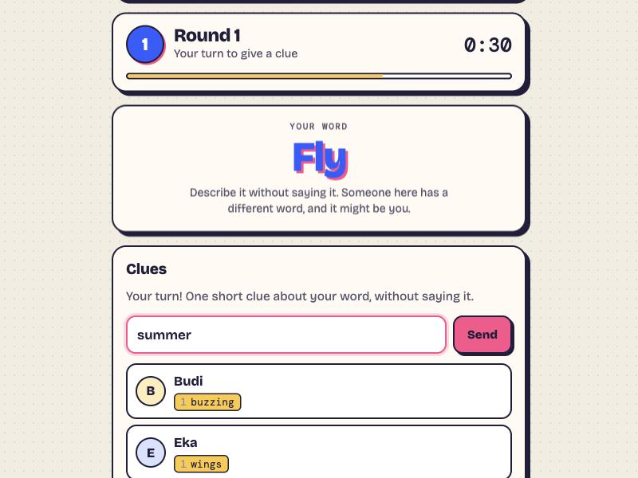

# Blend In

A word party game for your friend group. Everyone gets the same secret word, almost everyone. Give clues, find who doesn't fit, and if the odd word is yours, blend in.

### ▶ [Play now](https://granodioritee.github.io/blend-in/)

## How it plays

- Most players are **Civilians** and share one word, say *Coffee*
- The **Undercover** gets a close but different word, say *Tea*, and doesn't know they're the Undercover
- **Mr. White** (optional, from 5 players) gets no word at all and has to bluff
- Everyone takes turns giving a clue of up to three words; the first vote comes once everyone has given two
- Vote someone out, or vote to skip. Miss your turn twice in a row and you're out
- A Mr. White who gets voted out can still win by guessing the Civilians' word

## Features

- 3 to 12 players, each on their own phone: create a room and share the invite link
- Words in Bahasa Indonesia or English, over 300 pairs
- An optional 21+ pack of adult word pairs, off unless the host turns it on
- Clues are typed, so it works over a video call as well as in the same room
- Chat and quick reactions ("Sus 👀") pop up as bubbles on everyone's screen

## No peeking

Each player's word sits in a slot only they can read, and which slot is the Undercover's is never readable by anyone, so not even the Undercover can find out from the code. When someone is voted out, their role is checked against the deck by the database rules, and so is Mr. White's guess.

## How it's built

One HTML file with no build step, hosted on GitHub Pages, with Firebase Realtime Database and anonymous sign-in. The game is run by the browser of one online player and hands over automatically if they leave.

---

Made by [granodioritee](https://github.com/granodioritee). Also try [Make it 24](https://github.com/granodioritee/make-it-24), [Spy Words](https://github.com/granodioritee/spy-words) and [Werewolf](https://github.com/granodioritee/werewolf).
